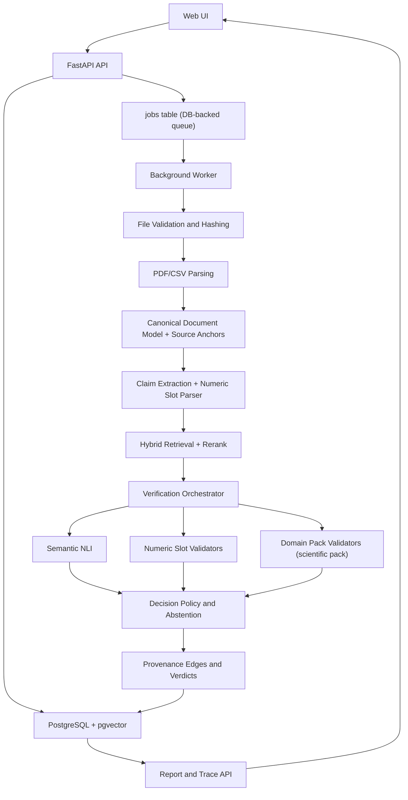

# EvidenceGraph
## Traceable, Numerically-Grounded Claim Verification with Abstention

**Document type:** Product, architecture, evaluation, and DevOps blueprint (v2, scoped)
**Status:** Proposed implementation plan
**Team:** 4 people, implementing with an AI IDE (see `implementation.md`)
**Deployment target:** Zero-cost, self-hosted, open-source only, CPU-only
**Evaluated domain:** Scientific and technical reports (one domain, end to end)
**Architecture:** Domain-neutral core with a domain-pack interface (only one pack implemented)
**Primary principle:** Every verdict must be traceable to source evidence and reproducible verification steps.

---

## 1. Executive Summary

EvidenceGraph checks claims in a report against the evidence supplied with it (tables, text, CSVs). It extracts checkable claims, retrieves evidence, verifies the claim with both a language model (NLI) and deterministic numeric code, and stores a provenance graph so a reviewer can reconstruct every decision. When evidence is weak, ambiguous, or badly extracted, it abstains instead of guessing.

### What is new here (the contribution)

The individual parts (claim verification, table fact-checking, numeric reasoning, provenance) exist in prior work. The contribution we claim is the **combination, evaluated end to end**:

> A neuro-symbolic verifier that normalizes each numeric claim into explicit slots (metric, entity, period, unit, scale, denominator, rounding) and checks them against evidence with deterministic code, combined with calibrated abstention and a reproducible provenance trail, and measured against semantic-only baselines on scientific reports.

This is applied novelty. It must be supported by a literature check (see Risks) and by the ablations in Section 7. Do not claim more than the results show.

### Core research question

Does adding deterministic numeric-slot verification and calibrated abstention to a retrieval + NLI pipeline improve detection of numeric inconsistencies, without materially degrading correct claims, compared with a semantic-only baseline?

### Non-goals

EvidenceGraph does not establish universal truth, replace professional judgment, certify compliance, or guarantee that claims are correct. It assesses claims against the evidence supplied and represents missing evidence and uncertainty explicitly.

Also out of scope for the MVP: multiple implemented domains, OCR, web crawling, multi-language support, report rewriting, multi-tenancy, paid APIs, and monitoring stacks.

---

## 2. Product Requirements and Scope

### 2.1 Target users (MVP)

| User | Need |
|---|---|
| Researchers and reviewers | Check that summary claims match the paper's own result tables and supplied CSVs. |
| Engineers and analysts | Find unit, scale, period, or rounding mismatches between text and tables. |
| AI/data teams | Audit whether a generated or written report is supported by its sources. |

Other fields (engineering specs, environmental, financial, policy) are future domain packs, not MVP users.

### 2.2 Core value proposition

> Is this claim adequately supported by the supplied evidence, does any evidence contradict it, and can a reviewer reconstruct the decision?

Every claim result includes: claim text and location, retrieved evidence, source anchor (page, table, row, cell), NLI result, numeric-slot check with calculation trace, final status, abstention reason if any, versions of models, rules and policy, and review history.

### 2.3 MVP features

1. Upload a primary PDF and supporting CSVs (text-based PDFs only).
2. Validate files, hash them, store them under safe server-generated paths.
3. Extract text blocks, tables, and CSV rows with stable source anchors.
4. Extract checkable claims, with a focus on numeric and table-grounded claims, keeping original offsets.
5. Parse each numeric claim into the numeric-slot normal form (Section 4.6).
6. Retrieve evidence with BM25 + dense embeddings, fuse, and rerank.
7. Run pretrained NLI on claim-evidence pairs.
8. Run deterministic numeric-slot checks.
9. Apply the versioned decision policy (Section 4.8) to produce a verdict or abstain.
10. Persist every component result and graph edge.
11. Show claim, evidence, and source trail in a simple web UI; export JSON and a static HTML report.
12. Allow reviewers to correct claims and adjudicate verdicts, with history.
13. Re-run analyses reproducibly from pinned configuration.

### 2.4 Status definitions

| Status | Definition |
|---|---|
| Supported | The evidence supports the material aspects of the claim. |
| Partially Supported | Some material parts of a multi-part claim are supported, others are not. |
| Contradicted | Relevant evidence conflicts with the claim (a verified numeric mismatch, or high-confidence NLI contradiction). |
| Unsupported | No sufficient support was found in the supplied evidence. This does not prove the claim is false. |
| Needs Review | The system abstains because of ambiguity, incomparable slots, low extraction quality, or conflicting component results. |
| Processing Error | The source could not be processed reliably. This is not a claim verdict. |

### 2.5 Initial scope

Text-based PDFs and CSVs, English, scientific and technical reports with result tables, metrics, and experimental conditions. Run on a laptop or university machine, CPU only.

---

## 3. Architecture

### 3.1 Principles

- **Evidence first:** a verdict points to specific evidence.
- **Hybrid verification:** neural models interpret language; deterministic code checks what can be calculated.
- **Abstention:** missing or ambiguous evidence is never converted into certainty.
- **Reproducibility:** hashes, versions, thresholds, and intermediate outputs are stored.
- **Domain-neutral core:** the core assumes no domain vocabulary; domain rules live behind an interface.
- **Human oversight:** reviewers can inspect and correct uncertain results.
- **Security by design:** uploaded documents are untrusted input.
- **Add complexity only when measured:** no service is added without a measured need.

### 3.2 Data flow



### 3.3 Modular monolith and worker

One repository and shared domain code. The API and the analysis worker run as separate containers so model inference stays out of request handlers.

Runtime services (Docker Compose): `web`, `api`, `worker`, `postgres` (with pgvector). That is all.

### 3.4 Technology stack (all open source, zero license cost)

| Layer | Choice | Notes |
|---|---|---|
| Frontend | React, TypeScript, Vite, Tailwind | Minimal UI: upload, claim list, claim detail with trace, review form. |
| Trace view | Evidence tree in the claim detail page; static HTML graph in the report | React Flow only as a stretch goal. |
| API | Python, FastAPI, Pydantic | Typed contracts. |
| ORM / migrations | SQLAlchemy, Alembic | |
| PDF parsing | pdfplumber (MIT) for text and tables | Do not use PyMuPDF unless AGPL terms are acceptable. Docling is deferred (heavy on CPU). |
| CSV | Python `csv` / pandas | |
| NLP | spaCy (segmentation), sentence-transformers (embeddings, reranker), Transformers (NLI) | Models are examples to be confirmed in Week 1: a small embedding model (e.g., bge-small or MiniLM), a MiniLM cross-encoder reranker, and a DeBERTa-based NLI model. Verify each license and pin the revision. |
| Numeric | Python `Decimal`, Pint | SymPy is not needed for MVP. |
| Sparse search | `rank_bm25` in memory | Corpora are small; no extra service. |
| Dense search | pgvector | |
| Job queue | Postgres `jobs` table with `SELECT ... FOR UPDATE SKIP LOCKED` | Replaces RabbitMQ. |
| Packaging | Docker, Docker Compose | |
| Testing | pytest, HTTPX, Ruff, mypy, frontend tests | |
| CI | GitHub Actions free tier | Lint, tests, numeric regression, small eval gate. |
| Logging | Structured JSON logs | No Prometheus, Grafana, OpenTelemetry, or Valkey in MVP. |
| Optional compute | Free Colab/Kaggle notebooks for batch evaluation | Only for evaluation runs; the product runs locally. |

**Cost caveat.** Software license cost is zero. Compute, storage, and hosting are not inherently free; the plan assumes existing laptops or a university machine with at least 8 GB RAM (16 GB preferred). Verify each dependency's and model's license and pin revisions. Free AI-IDE tiers have usage limits (see `implementation.md`).

**Removed from v1:** RabbitMQ, Valkey, Prometheus, Grafana, OpenTelemetry, Docling, SQLite FTS5, SymPy, external API judge.

### 3.5 Canonical document model

Every format normalizes to one representation: document id and SHA-256, original filename as metadata only, signature validation result, pages and blocks, paragraphs with character offsets, tables with headers, rows and cells, CSV row/column identities, bounding boxes when available, extraction method and confidence, parser version.

Every claim and evidence object references a stable **source anchor**. A page number alone is not enough when the claim or evidence is in a table cell or CSV row.

### 3.6 Claim schema

```json
{
  "claim_id": "stable-id",
  "claim_text": "Original text of the claim",
  "claim_type": "quantitative | comparative | temporal | citation | categorical | other",
  "source_anchor_id": "source-anchor-id",
  "numeric_slots": null,
  "extraction_method": "rule-or-model-version",
  "extraction_confidence": 0.0
}
```

`numeric_slots` follows Section 4.6. Fields the text does not establish stay `null`; they are never guessed. The schema is conceptual; implement it as Pydantic models with database constraints.

### 3.7 Provenance data model

| Table | Purpose |
|---|---|
| `projects` | Group documents and configuration |
| `documents` | File identity, hash, type, processing metadata |
| `source_locations` | Page, offsets, table, row, column, bounding box |
| `evidence_chunks` | Paragraphs, table segments, CSV rows |
| `claims` | Original claims and extracted attributes |
| `retrieval_candidates` | Candidate evidence, ranks, scores |
| `verification_results` | Per-component outputs (NLI, numeric, domain rules) |
| `numeric_checks` | Parsed slots, units, calculations, tolerances |
| `graph_edges` | Typed directed provenance relationships |
| `analysis_runs` | Pipeline configuration, model, rule, and policy versions |
| `verdicts` | Final status, abstention reason, policy version |
| `review_events` | Human edits and adjudications |
| `jobs` | Queue: status, attempts, locked_at, payload |

Edge types: `CLAIM_EXTRACTED_FROM`, `CLAIM_SUPPORTED_BY`, `CLAIM_CONTRADICTED_BY`, `EVIDENCE_LOCATED_IN`, `RESULT_DERIVED_FROM`, `CHECK_EXECUTED_DURING`, `CLAIM_REVIEWED_BY`.

A claim can link to many evidence items. Store each relationship; never collapse into one unexplained score. Use PostgreSQL edge tables; no graph database.

### 3.8 Domain pack interface

The core calls domain packs through a stable interface. **Only `scientific_research` is implemented.** Other domains are described as future work.

```python
from typing import Protocol

class DomainPack(Protocol):
    name: str
    version: str

    def claim_patterns(self) -> list: ...
    def applicable_validators(self, claim) -> list: ...
    def validate(self, claim, evidence) -> "ValidationResult": ...
```

Before use, define concrete request/response schemas, error behavior, and versioning. Keep one shared deployment; load the pack per project.

---

## 4. Verification Pipeline

### 4.1 File validation
Allowlist extensions (`.pdf`, `.csv`); check real file signatures; enforce size, page, CPU, memory, and time limits; generate server-side ids and paths; hash originals; parse in an unprivileged worker; treat document text as data, never instructions.

### 4.2 Extraction and source anchoring
Extract text, tables, headers, footnotes, and CSV structure while preserving positions. If a table's structure is unreliable (merged cells, misaligned columns), flag the anchor `low_quality` so the policy can abstain. Scanned PDFs are out of MVP scope: detect and return Processing Error.

### 4.3 Claim extraction
Rules first: sentence segmentation, numeric patterns, metric keywords, table-row references. Preserve original spans; do not rewrite claims. A learned checkworthiness model is deferred until enough annotated data exists, split by document.

### 4.4 Hybrid retrieval
1. BM25 (in memory) and dense (pgvector) retrieval over paragraphs, table segments, and CSV rows.
2. Reciprocal-rank fusion; deduplicate.
3. Rerank with a cross-encoder.
4. Expand the evidence window to include table headers, units, captions, footnotes, and adjacent sentences.
5. Keep all anchors and scores.

A number without its metric, unit, period, denominator, or condition is misleading, so retrieval must carry that context.

### 4.5 Semantic verification (NLI)
Classify claim-evidence pairs as entailment, contradiction, or neutral. Store the raw label, score distribution, model revision, and evidence text. Thresholds are tuned on the development split. Model confidence is not a probability of truth.

NLI is weak on table cells and numbers. That is the gap numeric verification addresses and the reason for the ablation.

### 4.6 Numeric-slot normal form and verification

Each numeric claim and each candidate evidence value is parsed into:

| Slot | Example |
|---|---|
| metric | accuracy, F1, revenue |
| entity | Model A, Region X, treatment group |
| value and sign | 0.912, -3.4 |
| unit and scale | %, ms, million, mg/L |
| period or condition | 2023, test set, 5-fold CV |
| comparison basis | vs. baseline B |
| denominator | per 1,000, of total |
| precision / rounding | 2 decimals, "about" |
| source anchor | table 3, row 2, col 4 |

**Check procedure**
1. Match claim slots to evidence slots: metric, entity, period/condition, denominator.
2. If any required slot is missing or does not match, the result is `incomparable`, not `mismatch`.
3. Normalize units and scale (Pint, `Decimal`); distinguish percent from percentage points.
4. Compare values within a tolerance derived from stated precision (for example, half of the last reported digit) plus a documented rounding rule. Do not use one universal threshold.
5. Output one of `match`, `mismatch`, `incomparable`, `not_applicable`, with the calculation trace.

For derived claims such as growth:

```
growth_pct = (current - previous) / previous * 100
```

Calculate only when metric, entity, period, and basis of both values are comparable.

Keep distinct: percentage vs. percentage points; exact vs. rounded; quarterly vs. annual; reported vs. adjusted; measured vs. derived; missing evidence vs. contradictory evidence.

### 4.7 Scientific-pack validators (MVP)

| Validator | Purpose |
|---|---|
| Unit and scale | Detect mg vs. g, million vs. billion, ms vs. s |
| Period / condition | Detect train vs. test set, wrong year or fold |
| Table-to-text consistency | Match text claims to result-table cells |
| Arithmetic consistency | Check growth, differences, simple derived stats |

Validators state their assumptions. The system flags discrepancies; it does not decide scientific comparability on its own. Do not infer causation from association.

### 4.8 Decision policy v1 (versioned) and abstention

Inputs per claim: extraction confidence/quality flag, retrieval score, NLI label and probabilities, numeric result.

Rules are applied in order; the first matching rule wins:

| # | Condition | Verdict |
|---|---|---|
| 1 | Source of claim or best evidence is `low_quality` or extraction confidence below τ_ext | Needs Review |
| 2 | Numeric result = `mismatch` (all slots comparable, outside tolerance) | **Contradicted**, regardless of NLI |
| 3 | Numeric result = `incomparable` | Needs Review (reason recorded: which slot failed) |
| 4 | Best reranker score below τ_ret (no relevant evidence) | Unsupported |
| 5 | Numeric = `match` and NLI = contradiction ≥ τ_c | Needs Review (components conflict) |
| 6 | Numeric = `match` | Supported (NLI neutral or entailment) |
| 7 | Multi-part claim with some parts under rule 6 and others under rules 3-4 | Partially Supported |
| 8 | No numeric content: NLI entailment ≥ τ_e | Supported |
| 9 | No numeric content: NLI contradiction ≥ τ_c | Contradicted |
| 10 | Otherwise | Unsupported if NLI = neutral, else Needs Review |

Notes:
- A verified numeric contradiction is never overridden by high semantic similarity.
- A difference between unrelated metrics is `incomparable`, never `mismatch`.
- Missing evidence is never reported as falsehood.
- Thresholds (τ_ext, τ_ret, τ_e, τ_c) are set on the development split, recorded in the policy version, and frozen before touching the test split.
- Store every component result separately so a reviewer can see why a status was assigned.

### 4.9 Provenance and reporting
Generate reports from persisted records, not from a new ungrounded model response. Include claim, status, supporting and contradicting evidence, source locations, numeric calculation trace, versions, abstention reason, limitations, reviewer decisions, run timestamp, and input hashes.

---

## 5. Domain Strategy

**Implemented:** `scientific_research` (claims: accuracy/precision/recall, sample size, effect size, result-table comparisons; checks as in 4.7).

**Future work (not implemented, no claims made):** engineering specifications (limits, tolerances, requirement-to-test tracing), environmental reports (concentrations, unit conversion, before/after), financial reports (currency, scale, period, denominator). The interface in 3.8 is the extension point.

**Generalization claim:** none. We state that the core is domain-neutral by design and evaluated on one domain only. Adding a second domain with its own benchmark would be the next step.

---

## 6. Implementation Roadmap (10 weeks, 4 people)

Detailed task assignment, human vs. AI work, and weekly gates are in `implementation.md`.

| Weeks | Focus | Output |
|---|---|---|
| 1 | Contracts and setup: schemas, interfaces, repo, CI, license check, corpus selection | Frozen v0 contracts, running Compose stack |
| 2 | Ingestion, source anchors, jobs queue, annotation guidelines | Upload to anchored chunks in the DB |
| 3 | Claim extraction, numeric-slot parser, first annotated set | Claims with slots; extraction metrics |
| 4 | Retrieval (BM25, dense, fusion, rerank) | Recall@k on dev set |
| 5 | NLI and numeric validators | Component results stored |
| 6 | Decision policy and end-to-end pipeline | **First E2E milestone (Section 11)** |
| 7 | UI, report export, synthetic benchmark generator | Reviewable results, synthetic set |
| 8 | Evaluation harness and ablations v1 | First results tables |
| 9 | Threshold calibration, risk-coverage curves, security and robustness tests | Frozen policy |
| 10 | Final held-out test run, reproducibility check, write-up, demo | Final results and report |

---

## 7. Evaluation and Research Methodology

### 7.1 Datasets

1. **Synthetic perturbation benchmark (primary, scalable, free).** Take real claims and real result tables from public papers and programmatically perturb a claim to create labeled cases:
   - changed number beyond tolerance (Contradicted)
   - rounding within tolerance (Supported)
   - unit or scale swap (Contradicted)
   - period or condition swap (Contradicted)
   - percent vs. percentage points swap
   - entity swap
   - claim with evidence removed (Unsupported)
   - ambiguous or low-quality table (Needs Review)

   Labels come from the generator, so ground truth is exact and the numeric-check ablation is clean.
2. **Hand-annotated real set (about 100-150 claims)** from public papers, to check realism. At least two annotators label a shared subset (about 40 claims) independently; report agreement (for example Cohen's kappa) and adjudicate disagreements.
3. **External sanity checks** on public datasets such as SciFact, SciTab, and TAT-QA. Verify each license and usage terms first. These test the components, not the whole pipeline.

All splits are **by document**: train/dev/test never share a source paper. Keep the test split sealed until the policy is frozen.

### 7.2 Metrics

| Task | Metrics |
|---|---|
| Claim extraction | Precision, recall, F1 |
| Slot parsing | Per-slot accuracy (value, unit, scale, period, denominator) |
| Retrieval | Recall@1/5/10, source-anchor accuracy |
| Verdict classification | Per-class precision/recall/F1, macro-F1, confusion matrix |
| Numeric verification | Mismatch detection precision/recall, false-contradiction rate |
| **Abstention** | **Risk-coverage curve** (accuracy on answered claims vs. fraction answered), abstention rate |
| Provenance | Share of verdicts with a complete trace, source-location accuracy |
| Calibration | Brier score or ECE (with an appropriate method) |
| Operations | Latency per claim, RAM, failure rate, reproducibility of reruns |

Report confidence intervals (for example bootstrap, resampling by document).

### 7.3 Baselines and ablations

Compare on the same claims and, for the direct ablation, the same retrieved evidence:

1. BM25 + NLI
2. Hybrid retrieval + NLI
3. Hybrid + reranker + NLI
4. Hybrid + reranker + NLI + numeric-slot verification (full system)
5. Optional: a small local LLM judge via Ollama, only if hardware allows

Further ablations: remove dense retrieval, remove reranker, remove table context expansion, remove abstention (always answer).

**Central hypothesis:** row 4 detects numeric inconsistencies better than row 3, with no material loss on correct claims. Do not claim superiority unless the results show it.

### 7.4 Pilot targets (hypotheses, expect to revise)

- Evidence Recall@5 of at least 0.90
- Slot-parsing accuracy of at least 0.95 on supported formats
- Verdict macro-F1 of at least 0.80 on the synthetic set
- High-confidence contradiction precision of at least 0.90
- Every finalized verdict has a complete, reproducible trace
- Re-run with pinned configuration gives identical verdicts

Recalibrate after the first baseline measurement.

---

## 8. DevOps, Deployment, and Security

### 8.1 Zero-cost setup
Docker Compose on an existing machine: `web`, `api`, `worker`, `postgres`. Models run locally on CPU. No paid APIs on any default path. Free Colab/Kaggle may be used only for batch evaluation.

### 8.2 Public demo (optional)
A free CPU host may have sleep, memory, and storage limits. If used: public or synthetic documents only, temporary retention stated, no SLA. Local Compose is the canonical setup. A recorded walkthrough is an acceptable substitute.

### 8.3 CI
Pull request: lint and type check, unit tests, integration tests, numeric regression tests (golden cases), small evaluation gate on a fixed mini-set, container build, dependency scan. Changes that alter verdicts require benchmark results in the PR.

### 8.4 Logging
Structured JSON logs with project, document, job, and run ids. Do not log full document contents. Track queue depth, failures, and per-stage latency in logs or a simple status endpoint.

### 8.5 Security checklist
- Validate extensions and file signatures; enforce size, page, memory, and time limits.
- Safe random storage paths; unprivileged worker.
- No arbitrary URL fetching or command execution.
- Escape extracted text in the UI.
- Authorization checks for project, document, and report access.
- Retention and deletion policy; test backup and restore.
- Treat document text as data, never instructions.
- Pin and review dependencies and model artifacts.

---

## 9. Risks and Mitigations

| Risk | Mitigation |
|---|---|
| Scope too large for 10 weeks | One domain, cut infrastructure, weekly gates, freeze scope at Week 6. |
| Annotation bottleneck | Synthetic benchmark does most of the work; real set limited to about 100-150 claims. |
| PDF table extraction errors | Anchor-quality flags, regression fixtures, abstain on low quality, curated corpus. |
| False numeric contradictions | Require all slots to match before `mismatch`; otherwise `incomparable`. |
| NLI overconfidence | Calibrate on dev split, store raw outputs, abstain. |
| Dataset leakage | Split by document; sealed test set. |
| Novelty overclaimed | Do a short literature review in Weeks 1-2; state novelty as applied and combination-level; support it with ablations. |
| License problems (models, PyMuPDF AGPL, datasets) | Maintain a license inventory; prefer permissive licenses; pin revisions. |
| AI-generated code defects | Contracts and tests written first by humans; mandatory human review (see `implementation.md`). |
| Free AI-IDE usage limits | Small task cards, plan prompt budget, keep a fallback assistant. |
| Over-engineering | Add services only when measured need appears. |

---

## 10. Repository Structure

```text
evidencegraph/
├── apps/
│   ├── api/            # FastAPI
│   └── web/            # React + Vite
├── worker/
│   ├── ingestion/
│   ├── extraction/     # claims + numeric slot parser
│   ├── retrieval/
│   ├── verification/   # nli, numeric validators, decision policy
│   └── reporting/
├── domain/
│   ├── schemas.py      # Pydantic contracts (human-owned)
│   ├── policies.py     # decision policy + thresholds (human-owned)
│   └── provenance.py
├── domain_packs/
│   └── scientific_research/
├── persistence/
│   ├── models.py
│   └── migrations/
├── evaluation/
│   ├── datasets/       # synthetic generator, splits
│   ├── annotations/
│   ├── baselines/
│   └── metrics/
├── tests/
│   ├── unit/
│   ├── integration/
│   ├── regression/     # numeric golden cases
│   └── security/
├── infra/docker/
├── AGENTS.md           # rules for the AI IDE (see implementation.md)
├── docker-compose.yml
├── .env.example
└── README.md
```

Create directories as modules are implemented.

---

## 11. First End-to-End Milestone (target: end of Week 6)

1. Upload one public research PDF and one supporting CSV.
2. Extract 5-10 claims with numeric slots.
3. Retrieve evidence for each claim.
4. Run NLI and numeric verification.
5. Flag at least one deliberately introduced inconsistency as Contradicted.
6. Produce at least one Needs Review and one Unsupported case with recorded reasons.
7. View the claim-to-evidence-to-source trail and export the JSON report.
8. Re-run with pinned configuration and get identical results.

**Acceptance criterion:** every finalized claim has a visible source trail, every numeric result has a calculation trace, and uncertain claims are never presented as established facts.

---

## 12. Final Architecture Decision

Build EvidenceGraph as a **traceable, numerically-grounded claim verifier with abstention, evaluated on scientific reports**, with a domain-neutral core and a domain-pack interface as the extension point.

Stack: React + TypeScript, FastAPI, PostgreSQL + pgvector, DB-backed job queue and worker, in-memory BM25 + dense retrieval + reranking, pretrained NLI, deterministic numeric-slot validation, relational provenance graph, Docker Compose, pytest, GitHub Actions.

Do not fine-tune several models, add message brokers, caches, monitoring stacks, or graph databases, or build apps for other domains before the MVP shows value.

The contribution is demonstrated by controlled evaluation: whether numeric-slot verification and calibrated abstention make results more reliable and inspectable than semantic-only baselines.

**Strategy: design for several domains, implement and validate one, and state generalization only as future work.**

---

## Appendix: Changes from v1

| Area | v1 | v2 |
|---|---|---|
| Framing | Cross-domain platform | Numerically-grounded verification with abstention; one evaluated domain |
| Domain packs | 4 packs sketched | Interface kept; 1 pack implemented |
| Queue | RabbitMQ | Postgres jobs table |
| Services | web, api, worker, postgres, rabbitmq, valkey, prometheus, grafana | web, api, worker, postgres |
| Sparse search | SQLite FTS5 (second store) | `rank_bm25` in memory |
| Parser | Docling | pdfplumber; no OCR in MVP |
| Judge baseline | Local and external API LLM | Optional local only (zero-cost) |
| Numeric core | Field list | Numeric-slot normal form + check procedure |
| Decision policy | Rules of thumb | Ordered, versioned rule table incl. NLI-to-verdict mapping |
| Data | 300-500 hand-labeled claims | Synthetic perturbation benchmark + 100-150 hand-labeled real claims |
| Evaluation | Metrics and ablations | Adds risk-coverage curves, document-level bootstrap CIs, inter-annotator agreement |
| Timeline | 10 weeks, unspecified team | 10 weeks, 4 people, E2E milestone at Week 6 |
